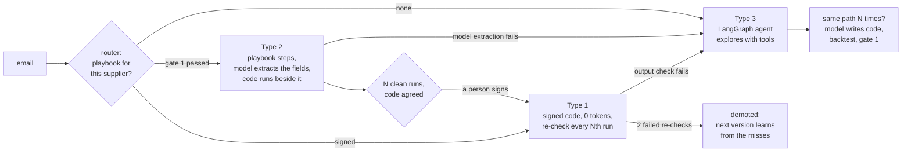
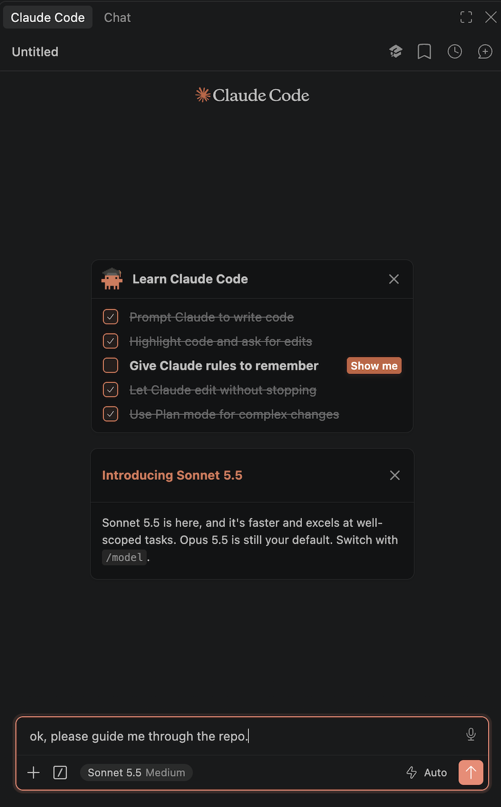

# zero-token-joule-agents


> **“If an agent already solved it a hundred times, why is run 101 still reasoning?”**

An agent that stops calling the model for the cases it has already learned, and measures how much of its traffic still needs one.

It is an SAP CAP (Node.js) app with a LangGraph.js agent inside. It works through a mailbox of 40 synthetic supplier emails and writes purchase orders. The first orders from a supplier go to the model. When the same path repeats, the agent asks the model for extraction code, tests that code against the past answers, and runs it next to the model until a person signs it. From then on that supplier's orders cost zero tokens, with a periodic re-check that can demote the code. SAP Joule can call the agent over A2A.

**This repository is educational.** It exists to show that one idea with a small agent you can run, read and measure. It is inspired by Progressive Crystallization (Arun Malik, [arXiv 2607.07052](https://arxiv.org/abs/2607.07052)) and by the SAP TechEd Berlin 2026 session CT1106, “Zero token architecture for Joule Agents”, which covers the same pattern. It is not the code shown in the talk. The data is invented, the default model is simulated, and nothing here is production code.

## Three types of run

| Type | Who decides | Model tokens per run |
|---|---|---|
| 3 | the agent explores the whole case with its tools | thousands |
| 2 | a playbook runs fixed steps; the model only extracts the order fields | about a hundred |
| 1 | signed code; no model at runtime | 0 |

The type is computed from the run log, never declared. The number to watch is the ratio of the three over time. `Type 1 : 2 : 3 = 38 : 35 : 27` means 38 percent of the runs cost nothing. The repository's name is that goal for the repeated part of the traffic. The rest stays with the model, and the ratio says how much that is.

## How a case moves between types



The route depends on the sender's domain and the playbook's status, not on the model. Every run writes the same record: tool calls, inputs, outputs, tokens, outcome. The proposal step, the ratio and the calculator read nothing else. The mechanics are in [docs/how-it-works.md](docs/how-it-works.md); the reasoning behind the gates is in [docs/concept.md](docs/concept.md).

## Run it with a coding agent (suggested)

This repository is made to be run with a coding agent (Claude Code, Codex, Cursor, Copilot agent mode or similar). It is a suggestion, not a requirement: the next section runs everything by hand. With an agent the experience is more streamlined, because [AGENTS.md](AGENTS.md) turns it into a guide. Open the folder in your agent and ask it to guide you through the repo:

<p align="center">
  
</p>

The agent then runs the commands for you, one step at a time, and explains what happened with the real output: the code the model wrote, where it should work and where it can fail, and which app to look at on screen. It answers in your language. The signature at gate 2 stays yours: the agent shows the evidence and does not sign by itself. It never asks for an API key in the chat; if you want a real model, you paste the key into `.env` yourself.

## Run it

Node 22 or newer. No API key, no SAP account.

```bash
git clone https://github.com/eamarce/zero-token-joule-agents
cd zero-token-joule-agents
npm install
npm test
npm start           # http://localhost:4004
```

The cockpit is the launchpad at http://localhost:4004/launchpad/index.html, with four apps: Agent, Playbooks, Calculator and Joule (A2A). There is no login on your own machine (you act as the demo user `alice`). The Agent and Playbooks apps do not refresh by themselves: press **Refresh** to see runs and playbooks that started elsewhere, such as the terminal. Or drive the agent from a second terminal:

```bash
npm run ctl -- next 10      # explores, proposes code, stops when playbook v1 waits for a signature
npm run ctl -- show         # the code the model wrote, its backtest, the decision log
npm run ctl -- sign         # alice signs; Northwind's orders now cost 0 tokens
npm run ctl -- next 30      # drift, two failed re-checks, demotion, v2 proposed; stops for its signature
npm run ctl -- sign
npm run ctl -- next 10
npm run ctl -- ratio
npm run ctl -- report       # out/report.html with charts
```

`npm run ctl -- help` lists the rest. The database is in memory, so a restart starts over; `npm run ctl -- export runs.jsonl` keeps the history.

**To start over from zero**, run `npm run ctl -- reset` (or press Reset in the Agent app). It deletes all runs, playbooks and signatures and marks the mailbox unread again; the code, `.env` and git are not touched. A server restart does the same, and is also needed after you change `.env` or `ZT_PROFILE`. Export first if you want to keep the history. [AGENTS.md](AGENTS.md#starting-over) has the steps a coding agent follows.

## What one pass shows

With the `demo` profile in [config/profiles.json](config/profiles.json):

| Emails | What happens |
|---|---|
| 1 to 3 | Northwind's first orders. The agent explores each one with its tools (Type 3). |
| after 3 | Same tool path three times. The model writes `extract(input)`, the backtest matches all three past answers, gate 1 opens. |
| 5 to 10 | Playbook v1 (Type 2). The model extracts the fields; the code runs beside it and agrees five times in a row. |
| 10 | Gate 2: a named person signs. A technical user or an agent cannot. |
| 11 onward | v1 writes orders with no model call (Type 1). Every fourth run the model reads the same email and the two answers are compared. |
| 13 | A question from Northwind. The code's output fails the check, the case falls back to the model, which drafts a reply. |
| 16 to 25 | Northwind starts writing totals with a thousands separator. The code reads 3 where the email says 3,105.50. That is a valid shape, so the output check passes. Three wrong orders go through before two re-checks disagree and v1 is demoted. |
| 26 | The agent proposes v2 from the cases v1 got wrong. Backtest 12 of 12, then the same gates and a second signature. |
| 37 | Contoso's third order. The code the model writes for Contoso's European number format fails the backtest, so Contoso stays with the model. |

The pass ends at `38 : 35 : 27` over 40 runs. The wrong orders can be counted only because the synthetic mailbox carries the right answers. A real system has no such oracle; the re-check and the demotion are what it has instead.

## With a real model

Copy `.env.example` to `.env` and set one key. The agent then calls Claude, OpenAI or Gemini through LangChain and the token counts come from the API. A full pass is about 100 model calls; use a key with a spending limit. The simulated model writes a plausible bug on purpose so the demotion has something to catch. A real model may write a correct extractor and skip that chapter.

## The calculator

Point it at your own agent's log: the Calculator app in the launchpad, or `npm run ctl -- analyze <file>`. It computes the Type 1 : 2 : 3 ratio and ranks the paths that are candidates for signed code by the tokens they cost, answering four questions per path: repeated, stable, valuable, operable. It reads run-log JSONL ([schema/run-log.schema.json](schema/run-log.schema.json), the format this agent exports) or OpenTelemetry GenAI traces with three extra span attributes: `zt.task`, `zt.playbook_id`, `zt.outcome`. No model call, no key. Samples are in `samples/`; the mapping and the thresholds are in [docs/calculator.md](docs/calculator.md).

## Joule and BTP

The agent serves an A2A 0.3 agent card at `/.well-known/agent.json` and answers `message/send` at `/a2a`. The `joule/` folder holds a Joule Studio capability that forwards the user's message through a BTP destination with an `agent-request` action. [docs/deploy-btp.md](docs/deploy-btp.md) deploys the app to Cloud Foundry; [docs/deploy-joule.md](docs/deploy-joule.md) adds the capability to a Joule assistant.

Tested: the A2A endpoint (the end-to-end test calls it the way Joule does), `joule lint` and `joule compile` with `@sap/joule-studio-cli` 2.0.4. Not tested: deploying the capability to a Joule tenant. Read those steps as instructions, not as a report.

## Layout

```
srv/agent/          router, LangGraph explore graph, tools, crystallizer (proposals), model providers
srv/lib/            classify, four questions, backtest, sandbox, OpenTelemetry import, calculator
srv/a2a.js          agent card and JSON-RPC for Joule
db/schema.cds       mailbox, orders, runs, tool calls, model calls, playbooks, decisions
app/launchpad/      Fiori launchpad (UI5 sandbox shell) with one tile per app
app/agent/          Fiori elements: runs worklist, ratio, process and reset
app/playbooks/      Fiori elements: playbooks worklist, object page, sign and reject
app/calculator/     SAPUI5 freestyle: opportunity calculator
app/joule/          SAPUI5 freestyle: A2A console
joule/              Joule capability (agent-request to the A2A endpoint)
data/mailbox.json   the 40 synthetic emails, generated by scripts/make-mailbox.js
samples/            a run log and an OpenTelemetry trace for the calculator
scripts/ctl.js      the command line used above
mta.yaml, xs-security.json, router/, deploy/cf/   Cloud Foundry deployment
```

## Limits

- Model-written code runs in `node:vm` with no `require`, no `process`, no I/O and a time limit. That catches honest mistakes, not hostile code. A real system needs a container or micro-VM. See [SECURITY.md](SECURITY.md).
- A backtest proves that the code reproduces the model's past answers. If the model was wrong then, the code inherits the mistake.
- One playbook per sender domain. A supplier that changes its template without changing its domain is caught late, by a re-check.
- The output check validates shape. A plausible wrong number passes it; only a re-check, a downstream control or a person catches it.
- Gate 1 here is the backtest alone. The paper's version also checks action-sequence consistency and safety violations. The demotion thresholds are mine.
- Simulated token counts are characters divided by four. They show the shape of the cost, not a price.
- The database is in memory, on your laptop and on BTP.
- Run logs hold whatever the tools read and wrote. Redact them before sharing.

## References

- Arun Malik, [Progressive Crystallization](https://arxiv.org/abs/2607.07052), arXiv 2607.07052. The three types and the `talk` profile's thresholds come from it.
- Xiangyi Li et al., [SkillsBench](https://arxiv.org/abs/2602.12670), arXiv 2602.12670. Skills the models wrote for themselves scored below the no-skills baseline. It is why a person signs.
- SAP, [reference architecture for agentic AI](https://architecture.learning.sap.com/docs/ref-arch/ca1d2a3e): pro-code agents reached by Joule over A2A.

## License

MIT, Edgar Martinez. See [LICENSE](LICENSE).

SAP, SAP BTP, SAP Joule, SAP Fiori, SAPUI5 and the SAP Cloud Application Programming Model are trademarks or registered trademarks of SAP SE. This is an independent personal project, not affiliated with, endorsed or supported by SAP. The same goes for the other product names (Claude, OpenAI, Gemini, LangChain), which belong to their owners.
